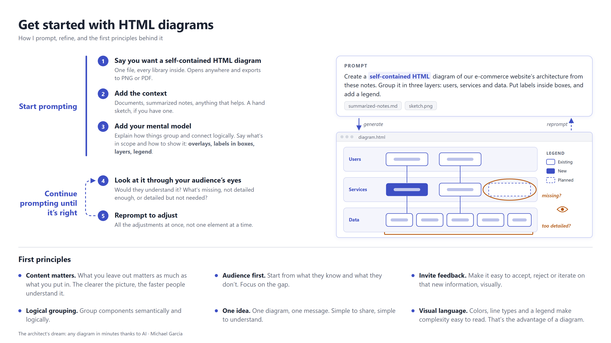
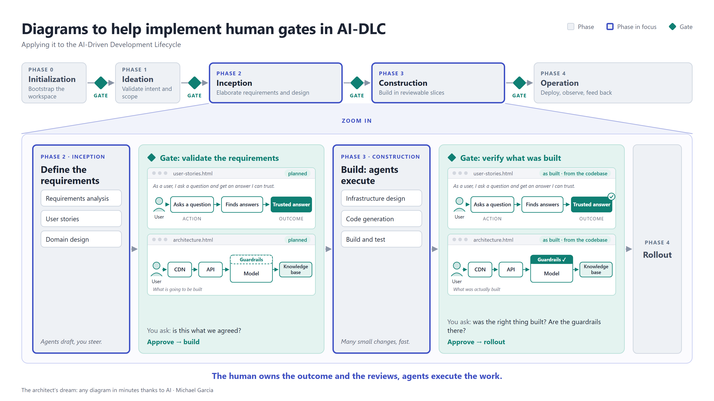
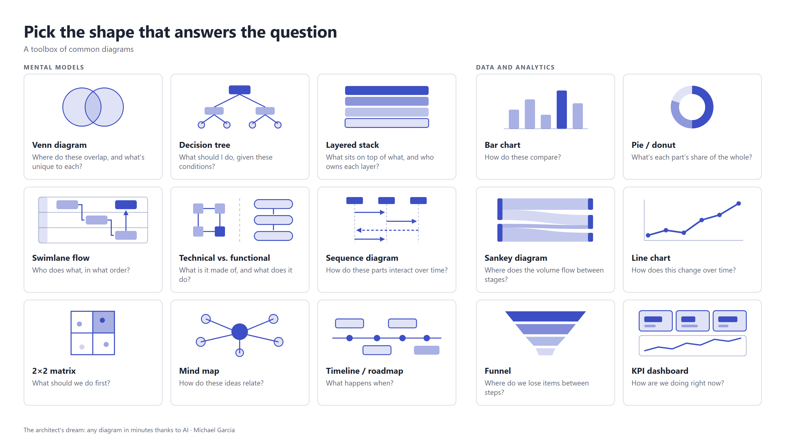

# html-diagrams

This repository is the companion to my blog article *The architect's dream: any diagram in minutes thanks to AI*.

### 1. Get started with HTML diagrams

### 2. Diagrams to help implement human gates in AI-DLC

### 3. Pick the shape that answers the question

